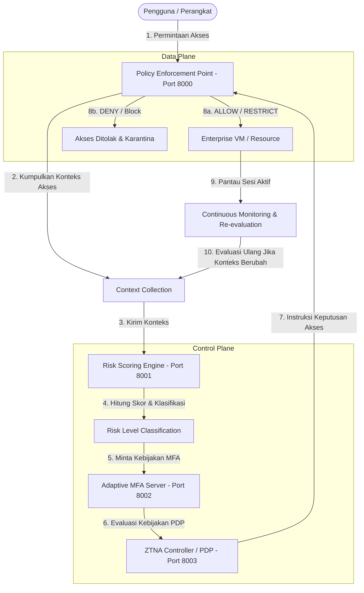

# 02 Arsitektur Sistem ZTNA Risk-Aware

> **Ringkasan:** Dokumen ini memberikan gambaran menyeluruh tentang arsitektur sistem Risk-Aware ZTNA dengan Adaptive MFA yang dirancang dalam penelitian ini. Arsitektur ini terdiri dari beberapa komponen utama yang saling terhubung untuk memverifikasi identitas, menilai risiko, dan membuat keputusan akses secara dinamis. Alur data dan interaksi antar komponen dijelaskan secara rinci mulai dari permintaan akses oleh pengguna hingga pemantauan berkelanjutan. Diagram Mermaid juga disertakan untuk mempermudah visualisasi alur sistem.

---

## 1. Gambaran Umum Komponen Sistem

Sistem ini mengadopsi prinsip dasar Zero Trust Architecture dari standar **NIST SP 800-207**, yang memisahkan antara kontrol keputusan (Control Plane) dan eksekusi akses (Data Plane).

Berikut adalah komponen utama yang membangun sistem:

### A. Policy Enforcement Point (PEP)
- **Port:** 8000
- **Fungsi:** Bertindak sebagai *reverse proxy* dan pintu gerbang utama yang mencegat semua lalu lintas jaringan dari perangkat pengguna menuju sumber daya enterprise. PEP tidak mengambil keputusan sendiri, melainkan meneruskan konteks permintaan ke Controller dan mengeksekusi instruksi akses (izinkan, batasi, atau tolak).

### B. Risk Scoring Engine (Risk Engine)
- **Port:** 8001
- **Fungsi:** Otak penilai risiko yang menerima data konteks akses (lokasi, perangkat, waktu, jaringan, riwayat login, perilaku, dan sensitivitas data). Komponen ini menghitung skor risiko berbobot antara 0.0 hingga 100.0 dan mengklasifikasikannya ke dalam empat tingkatan risiko.

### C. MFA Server
- **Port:** 8002
- **Fungsi:** Layanan penyedia dan penguji autentikasi multi-faktor adaptif. MFA Server menangani registrasi dan verifikasi faktor TOTP berbasis RFC 6238 serta simulasi WebAuthn/FIDO2.

### D. ZTNA Controller (Policy Decision Point / PDP)
- **Port:** 8003
- **Fungsi:** Otak pembuat keputusan kebijakan. Controller menerima hasil evaluasi skor risiko dari Risk Engine dan menentukan kebijakan akses mana yang berlaku (ALLOW, RESTRICT, DENY) serta syarat MFA apa yang harus dipenuhi pengguna.

### E. Enterprise Resource / Enterprise VM
- **Port:** Stub upstream service (misalnya port 8080)
- **Fungsi:** Aplikasi atau data internal perusahaan yang dilindungi oleh sistem ZTNA. Pengguna tidak bisa mengakses sumber daya ini secara langsung tanpa melewati PEP.

### F. Monitoring System (Prometheus & Grafana)
- **Port:** Prometheus (9090), Grafana (3000)
- **Fungsi:** Mengumpulkan metrik Kinerja dan keamanan secara terintegrasi (seperti latensi scoring, latensi keputusan ZTNA, dan jumlah permintaan berdasarkan tingkatan risiko) dari seluruh komponen melalui endpoint `/metrics`.

---

## 2. Diagram Arsitektur dan Alur Data

Berikut adalah diagram alur keputusan akses secara dinamis menggunakan diagram Mermaid.

---

## 3. Penjelasan Alur Kerja Sistem Langkah demi Langkah

1. **User/Device Request:** Pengguna mengirimkan permintaan HTTP ke PEP untuk mengakses aplikasi internal perusahaan.
2. **Identity & Device Verification:** PEP mengidentifikasi identitas pengguna dan informasi status perangkat yang dibawa dalam header atau token.
3. **Context Collection:** Sistem mengumpulkan 7 sinyal konteks lingkungan seperti lokasi IP, waktu permintaan, reputasi jaringan, status kepatuhan perangkat, dan sensitivitas resource.
4. **Risk Scoring:** Data konteks dikirim ke Risk Engine (Port 8001). Risk Engine menghitung skor akhir (0-100) dan menguraikan kontribusi poin tiap fitur secara transparan.
5. **Risk Level Classification:** Skor dikategorikan ke salah satu dari 4 level: Low (0-29), Medium (30-59), High (60-84), atau Critical (85-100).
6. **Adaptive MFA Policy:** Berdasarkan level risiko, MFA Server (Port 8002) menentukan apakah pengguna cukup pakai password, butuh TOTP, butuh WebAuthn, atau langsung diblokir.
7. **ZTNA Policy Decision:** ZTNA Controller (Port 8003) menggabungkan hasil risko dan aturan keamanan untuk membuat keputusan final: ALLOW, RESTRICT, atau DENY.
8. **Dynamic Access Control:** PEP menerima keputusan dan langsung mengeksekusinya. Jika diizinkan, lalu lintas diteruskan ke Enterprise VM. Jika dibatasi, fitur sensitif dinonaktifkan. Jika ditolak, koneksi diputus.
9. **Continuous Monitoring & Re-evaluation:** Selama sesi berlangsung, pemantauan dilakukan secara terus-menerus. Jika ada perubahan konteks (misalnya lokasi IP mendadak berubah), alur re-evaluasi terpicu otomatis dari awal.

---

## Keterbatasan (dari Milestone 0 & 1)

- Service PEP, MFA Server, dan ZTNA Controller saat ini baru berupa *skeleton* endpoint health check. Logika komunikasi antar-service dan verifikasi token secara penuh baru akan selesai pada Milestone 2 dan 3.
- Komunikasi antar-service di dalam Docker Compose saat ini masih menggunakan HTTP biasa (belum mTLS antar-service).

---

## Cek Pemahaman

**Pertanyaan 1:** Komponen manakah yang berfungsi sebagai Data Plane dan komponen mana yang berfungsi sebagai Control Plane dalam arsitektur ini?

> **Jawaban:** Data Plane dipegang oleh Policy Enforcement Point (PEP) yang mencegat dan meneruskan lalu lintas. Control Plane terdiri dari Risk Engine, MFA Server, dan ZTNA Controller yang menghitung risiko dan mengambil keputusan kebijakan.

**Pertanyaan 2:** Mengapa Risk Engine dipisah menjadi service tersendiri pada port 8001 dan bukan digabung di dalam PEP?

> **Jawaban:** Pemisahan ini mengikuti prinsip arsitektur microservices dan kriteria Zero Trust NIST SP 800-207. Hal ini membuat penilaian risiko bersifat independen, mudah diuji secara terisolasi, serta dapat diskalakan tanpa membebani kinerja PEP yang menangani proxy lalu lintas.

**Pertanyaan 3:** Apa yang terjadi pada langkah Continuous Monitoring jika kondisi perangkat tiba-tiba berubah saat sesi sedang berjalan?

> **Jawaban:** Pemantauan berkelanjutan akan mendeteksi perubahan konteks tersebut, lalu memicu alur re-evaluasi ulang ke Risk Engine dan ZTNA Controller. Jika skor risiko membengkak, hak akses sesi pengguna bisa langsung diturunkan atau dibatalkan secara parsial maupun total.
